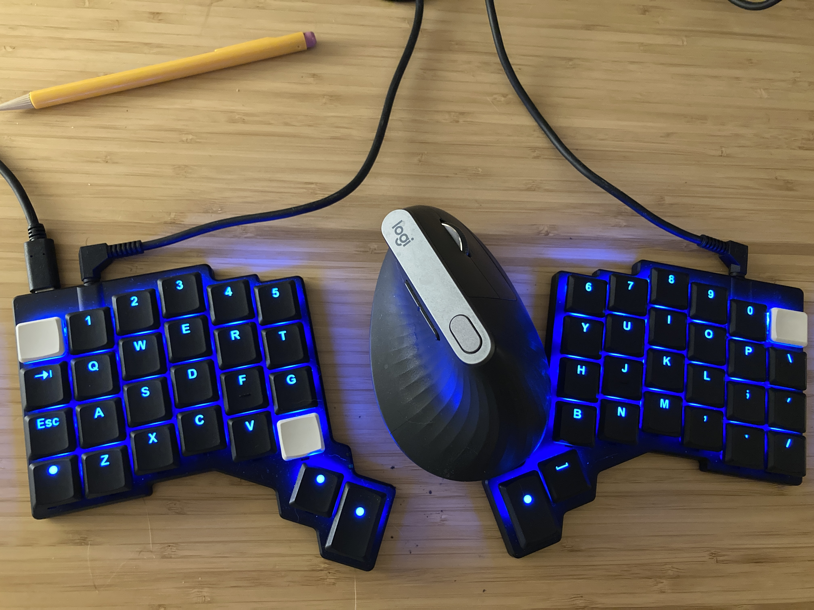

<small>_Last updated on Oct 28, 2026 from Mar De Las Pampas._</small>

## New Project

A new project pulled me out of my mini retirement sooner than I had expected. Tons of exciting challenges that I will write about soon. I've been pushing my agentic coding and workflow to new limits. My process keeps changing every couple of weeks. More to come...

## 10-day Vipassana Retreat

Finally! After more than a decade of meditating at home and learning how to do it from books and apps, I took the leap and did a 10 day retreat in Brandsen, Buenos Aires. I [captured](/retreat) the technique so I can come back to it in the future. Around day three, I started to realize that this was hard work. I was going to bed every night mentally, and some nights emotionally, exhausted from the work. I've decided to follow the teacher's recommendation and increase my daily meditation from 30 minutes to 2 hours. A lot of work awaits!

## Linux From Scratch

I built linux from scratch following the instructions in the [LFS book](/hello-worlds/hello-lfs). The things I ended up learning from the experience were very different from what I was imagining I would learn. I don't know if I'd ever make that my daily driver, but it's good to know that I have that option for things like embedded linux or if I ever wanted to build a locked down system.

## Tango

I finised [chapter three](https://nashkabbara.com/tango/book/) of my tango memoir! I'm currently doing research for chapter 4, titled The Centimeter. It's about technique. The research is in the form of learning and applying and codifying technique. I'll move to the writing stage once I have enough material and stories for the chapter. Tango takes about 2 hours a day from me in a combination of private lessons, solo practice, partner practice and daytime milongas.

## Reading & Listening

I started listening to the massive and wonderful [The Story of Civilization](https://www.amazon.com/dp/B074CF5NP9?binding=audio_download&ref=dbs_m_mng_rwt_sft_taud_tkin) series by Will Durant. There's more than 500 hours of listening in there.

I'm currently reading the following books:
* [Food Rules by Michael Pollan](https://www.amazon.com/dp/B002YJK5L4) [done]
* [Salt, Fat, Acid, Heat: Mastering the Elements of Good Cooking](https://a.co/d/eq1Kj2l)

## Graphite Layout

I've switched my work computer to [graphite](https://github.com/rdavison/graphite-layout) on Jan 1st. I'm currently (Oct 28th) reaching ~40wpm @ 98% accuracy and now completing 60s runs consistently. Finally moving from English 5,000 to English 10,000. This transition took 5 months of near daily practice! I'm using the <a href="https://www.zsa.io/voyager">Voyager</a> keyboard as my work computer driver and for my other computers I am using [Kanata](https://github.com/jtroo/kanata) to remap my [keyboards](https://github.com/nkabbara/dotfiles/blob/main/dot_config/kanata/leisure.kbd). I 100% vouch for Kanata. Amazing software.

Why have I decided to make my life temporarily miserable? I saw [videos comparing](https://www.youtube.com/watch?v=eNeYmr48JUM) qwerty with [modern layouts](https://www.youtube.com/watch?v=DKQ4pOoFh5I) and I was shocked at how much wrist and finger movement is involved with qwerty. Now, whenever I try to type qwerty, it feels complicated.

I'm typing daily on Monkeytype for at least 15 minutes working my way from English 200 to English 10K. I'll stop this when I can average 80wpm at 98% accuracy for the last 10 uninterrupted lessons. I have symbols and numbers turned on. I move up a level when I can finish a language setting at 40wpm/98% for average of last 10 successful sessions. Whenever I get bored of Monkeytype, I switch do [burst-type](https://www.burst-type.pro/)

<small>_(This is a now page, and if you have your own site, [you should check it out](https://nownownow.com/about).)_</small>
